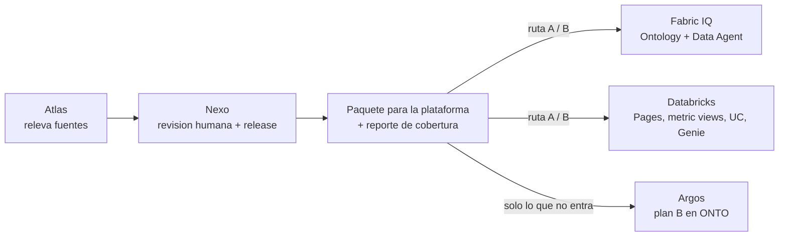

# Integracion con Fabric y Databricks

Estado: release 1 implementada (paquetes de archivos importables). Conectores directos y sincronizacion bidireccional: **no planificados** (ver [plan de reposicionamiento](18_PLAN_REPOSICIONAMIENTO.md)).
Relacion con el foco: ONTO **no compite** con la ontologia de Fabric ni con la de Databricks. Releva, valida y **entrega** a esas plataformas. El plan B (servir desde ONTO lo que la plataforma no puede implementar) queda congelado como caso excepcional.

## 1. Resumen ejecutivo

| Pregunta | Respuesta corta |
| --- | --- |
| Como entiende Fabric una ontologia | Como un item **Ontology** de Fabric IQ (experiencia nueva, TMDL): tipos de entidad con descripcion, sinonimos y propiedades, relaciones y reglas, y vinculos opcionales a tablas. Los KPIs y lo que no tiene entidad van al **Data Agent** como instrucciones. |
| Como entiende Databricks una ontologia | Como la **capa semantica de Unity Catalog** (Genie Ontology): Pages (conceptos de negocio), metric views (KPIs gobernados), dominios, comentarios y tags en tablas y columnas. Genie Agents la consume para responder. |
| Como les entregamos lo aprobado hoy | Nexo genera, desde una release aprobada, un **paquete de archivos** que cada plataforma importa: TMDL y cuerpo REST (Fabric), Markdown, YAML y SQL (Databricks), y archivos en estandares abiertos (OWL/Turtle y Ossie experimental). |
| Hace falta conector | No para la release 1. El paquete se importa con Git integration, la API REST o el editor SQL. El conector directo es la release 2. |
| Que pasa con lo que no entra | El paquete incluye un **reporte de cobertura** por elemento y recomienda la ruta: **A** (todo en la plataforma), **B** (mixta: plataforma + ONTO como plan B) o **C** (ninguna tabla alcanzable: ONTO como plan B, salvo que se construya un puente a los datos). |



## 2. Como interpreta cada plataforma

### 2.1 Microsoft Fabric (Fabric IQ)

- **Item Ontology** (preview, **experiencia nueva basada en TMDL**; la anterior, de JSON por entity type, se retira el **2027-01-31**). Partes de la definicion (documentacion de Microsoft Learn consultada el 2026-11-24):
  - `.platform` (version de config `2.0`), `database.tmdl` y `model.tmdl` (con `ref entity`, `ref namespace default` y `ref rule`);
  - `namespaces/default.tmdl` (obligatorio);
  - `entities/{nombre}.tmdl`: tipo de entidad con descripcion (`///`), `synonym`, `keyProperty` opcional y propiedades (`dataType`: `string`, `int64`, `double`, `dateTime`, `boolean`, `decimal`). Pueden definirse **sin tabla de respaldo** (ontology-first); el binding (`backingTable` y `backingConfiguration`) se agrega despues;
  - `entityRelationships.tmdl`: relaciones entre entidades (`fromEntity`, `toEntity`; el respaldo en una relacion de tabla es opcional);
  - `rules/{regla}.tmdl`: regla en lenguaje natural (`statement`) con las entidades que referencia;
  - `tables/`, `relationships.tmdl`, `expressions.tmdl` y `metrics/`: tablas de respaldo DirectLake, relaciones TOM, la conexion al Lakehouse y metricas (DAX de un modelo semantico). ONTO **no los genera** porque no conoce el workspace ni el Lakehouse.
- Tambien importa y exporta **RDF/Turtle/OWL** en una ontologia vacia: `owl:Class` es entity type, `owl:DatatypeProperty` es propiedad (con `rdfs:domain`), `owl:ObjectProperty` es relacion, `rdfs:label` es nombre, `rdfs:comment` es descripcion y `skos:altLabel` es sinonimo.
- Los KPIs, restricciones y reglas sin entidad referenciada van al **Data Agent** como instrucciones:
  - `Files/Config/data_agent.json`;
  - `Files/Config/draft/stage_config.json` con `aiInstructions`;
  - por fuente: `datasource.json` con `dataSourceInstructions` y descripciones de elementos, y `fewshots.json` (pares pregunta/consulta).
- Formas de crear: API REST `POST /v1/workspaces/{workspaceId}/ontologies` (`displayName` solo letras, numeros y `_`, `description` hasta 256 caracteres y `definition.parts` en base64), o carpeta del item en un repo conectado por **Git integration**.

### 2.2 Databricks (Unity Catalog semantics / Genie)

- **Pages**: conceptos de negocio con dominio, responsable, sinonimos, descripcion, cuerpo y activos relacionados. Se crean en la UI o por *bulk import* desde documentos. Los **Wikis** (documentar una tabla) y las relaciones entre metric views estan en Beta. La pagina de Pages ya no lleva la etiqueta Beta; confirmar el estado GA antes de afirmarlo a un cliente.
- **Metric views**: KPIs gobernados en YAML (version 1.1) con `source`, `joins`, `dimensions` y `measures` (nombre, expresion, comentario, sinonimos, formato). Se crean con `CREATE VIEW ... WITH METRICS LANGUAGE YAML AS $$ ... $$`.
- **Dominios y certificacion**: tags gobernados.
- **Comentarios, tags y constraints** de Unity Catalog: por SQL (`COMMENT ON`, `SET TAGS`, PK/FK).
- **Genie Agents** (antes Spaces): API `POST /api/2.0/genie/spaces` con `serialized_space` (version 2): tablas con descripcion y sinonimos de columnas, metric views, instrucciones de texto, ejemplos pregunta-SQL, joins, snippets y benchmarks. Los ids son hex de 32 caracteres y las listas van ordenadas.
- **Instrucciones de workspace** para Genie One: `/Workspace/.genie_workspace_instructions.md` (menos de 20.000 caracteres).

## 3. Correspondencia de elementos ONTO

| Elemento aprobado en Nexo | Fabric IQ | Databricks | Si no entra |
| --- | --- | --- | --- |
| Concepto / entidad | Entity type (con descripcion y sinonimos) | Page | - |
| Propiedad | Propiedad del entity type (tipo desde la columna aprobada) | Seccion de la Page y comentario de columna | - |
| Relacion | Entity relationship | Page e instrucciones del Genie Agent y join spec (si la release incluye la columna clave) | - |
| Sinonimo | `synonym` del entity type | Sinonimos de Page y columnas | - |
| Regla de negocio | Rule (si referencia una entidad aprobada) o instruccion del Data Agent | Instruccion del Genie Agent / Page | - |
| KPI | Instruccion del Data Agent (+ medida en el modelo semantico) | Metric view (expresion a completar) | - |
| Activo tecnico | Tabla del Lakehouse / modelo Power BI | Tabla de Unity Catalog | Plan B si la fuente esta fuera de alcance |
| Binding | Tabla de respaldo (se agrega en Fabric; requiere ids) | `COMMENT ON` + tags | Plan B si la fuente esta fuera de alcance |

Estados del reporte de cobertura:

- **Nativo**: se implementa tal cual.
- **Completar en la plataforma**: el paquete deja el esqueleto; falta un dato que solo conoce el equipo de la plataforma (ids, expresion SQL, tipo de dato).
- **Como instruccion**: entra como texto para el agente de IA de la plataforma.
- **Fuera de alcance**: la fuente no es alcanzable por esa plataforma (por ejemplo, un ERP on-premise). Queda en ONTO (plan B) o se trae con un puente: Mirroring/shortcuts en Fabric, Lakehouse Federation en Databricks.

Regla de recomendacion:

- **A**: todo es implementable en la plataforma.
- **B**: parte de los elementos queda fuera de alcance, pero al menos una tabla de la release es alcanzable.
- **C**: ninguna tabla de la release es alcanzable. La definicion se podria cargar, pero sin datos la plataforma no puede responder; ONTO (Argos) opera como plan B mientras no exista un puente.

La recomendacion es un punto de partida: la decision final la toma el equipo (costo, gobierno, licencias).

### 3.1 Cuando los datos viven fuera de la plataforma

Que la base este en otro lado (por ejemplo MySQL/MariaDB on-premises) **no descarta** por si solo a Fabric o Databricks. La ontologia de la plataforma necesita que la plataforma **alcance los datos**. Hay dos formas:

| Plataforma | Puente a una base externa | Implica |
| --- | --- | --- |
| Fabric | Mirroring si el origen es compatible, shortcut, o Copy job/pipeline de Data Factory hacia un Lakehouse (bases on-premises via *on-premises data gateway*) | Copia de datos y actualizacion programada |
| Databricks | Lakehouse Federation (MySQL, PostgreSQL, SQL Server, entre otras) o ingesta a Delta | Consulta sin copiar (requiere conectividad de red) o copia |

Cuando se construye el puente, los activos pasan a ser alcanzables y la ruta cambia a B o A **sin rehacer el trabajo de Nexo**: la release aprobada es la misma.

La ruta C es la correcta cuando el puente no se justifica. Caso tipico: una PYME sin Fabric ni Databricks, con una base legacy que no se quiere modificar y pocos usuarios. Ejemplo validado: el [caso Nalub](14_NALUB_REAL_CASE.md). Sus 33 tablas viven en MariaDB y el paquete recomienda **ruta C** para ambas plataformas; Argos ya responde en vivo, de solo lectura, con las consultas aprobadas.

## 4. Que genera ONTO hoy (release 1)

Desde Nexo, pestana **Release y entrega a la plataforma**, o con `prepare_interoperability_package(...)`:

```text
data/interoperability/<proyecto>/<release>/<destino>/<paquete>/
  publication_manifest.json   mapping.json   deployment_manifest.json   coverage.json
  export/
    coverage_report.md
    fabric/
      ontology/<Nombre>.Ontology/.platform, database.tmdl, model.tmdl, namespaces/default.tmdl,
                                  entities/<Entidad>.tmdl, entityRelationships.tmdl, rules/<Regla>.tmdl
      ontology/create_ontology_request.json        # cuerpo listo para la API REST
      data_agent/<Nombre>_agent.DataAgent/Files/Config/data_agent.json, draft/stage_config.json
      README_IMPLEMENTACION.md
    databricks/
      pages/<concepto>.md
      metric_views/<kpi>.yaml
      unity_catalog_comments.sql
      genie_workspace_instructions.md
      genie_agent_create_request.json               # cuerpo listo para la API de Genie
      README_IMPLEMENTACION.md
    open_standards/                                  # en ambos paquetes
      ontology.ttl                                  # OWL/Turtle: Fabric lo importa en una ontologia vacia
      semantic_model.ossie.yaml                     # Apache Ossie 0.3.0.dev0, EXPERIMENTAL (JSON = YAML valido)
      README.md
```

La pantalla muestra la ruta recomendada, cuantos elementos se implementan en la plataforma, la tabla de cobertura y un boton para **descargar el paquete en ZIP**. Parametros opcionales: nombre de la ontologia (Fabric); catalogo y warehouse (Databricks).

Validado con las demos: la demo comercial (fuente Power BI) recomienda **ruta A** en Fabric (13/13). La demo distribuida (ERP MariaDB + CRM SQL Server + lakehouse Databricks + Power BI) recomienda **ruta B** en ambas plataformas: 26/39 en Fabric y 33/45 en Databricks. El caso Nalub (solo MariaDB) recomienda **ruta C** en ambas.

## 5. Como se importa

**Fabric**

1. Revisar `coverage_report.md`.
2. Opcion Git: copiar la carpeta `<Nombre>.Ontology` (TMDL, experiencia nueva) al repo conectado al workspace y sincronizar. Opcion API: enviar `create_ontology_request.json` a `POST https://api.fabric.microsoft.com/v1/workspaces/{workspaceId}/ontologies` con identidad Entra autorizada. Opcion TTL: crear una ontologia vacia e importar `open_standards/ontology.ttl` (revisar el resumen de importacion: elementos preservados, ajustados o no soportados).
3. En el editor de la ontologia: completar los tipos marcados y agregar los data bindings (tabla de Lakehouse y columna por propiedad).
4. Crear el Data Agent (o copiar la carpeta `.DataAgent`) y agregar las fuentes de datos. Las instrucciones ya vienen redactadas.

**Databricks**

1. Revisar `coverage_report.md` y reemplazar identificadores si el catalogo no coincide.
2. Ejecutar `unity_catalog_comments.sql` en un SQL warehouse.
3. Completar las expresiones de cada metric view y crearlas con `CREATE VIEW ... WITH METRICS LANGUAGE YAML`.
4. Cargar las Pages (UI o bulk import desde los `.md`).
5. Crear el Genie Agent con `genie_agent_create_request.json` y subir `genie_workspace_instructions.md` al workspace.

## 6. Limites conocidos

- Fabric IQ Ontology esta en preview y Apache Ossie esta en incubacion (version 0.3 dev): los formatos pueden cambiar. El generador de Fabric esta aislado en `fabric_ontology.py` y el de estandares abiertos en `open_standards.py`; el export de Ossie es **experimental** y la version de la especificacion se declara en el archivo. El export a OWL/TTL no representa reglas, KPIs ni restricciones.
- La ontologia de Fabric se entrega **sin tablas de respaldo** (ontology-first). Si un concepto no tiene propiedades aprobadas se agrega `Nombre` como propiedad por defecto. No verificamos la importacion en un workspace real: eso lo cubre el piloto de [validacion en plataformas](pilotos/PILOTO_VALIDACION_PLATAFORMAS.md).
- ONTO no conoce ids de workspace, lakehouse ni warehouse: los data bindings de Fabric y el `warehouse_id` de Databricks se completan en la plataforma (o se pasan como parametro).
- Las expresiones de KPI no se inventan: el metric view sale con `COMPLETAR_EXPRESION_AGREGADA`. Si el KPI esta vinculado a una medida de un modelo Power BI, su DAX se incluye como **propuesta** (comentario en el YAML y en las instrucciones del Data Agent de Fabric) para que el equipo de datos la convierta a SQL y la valide.
- Los tipos de propiedad se toman de la columna aprobada que coincide por nombre con la propiedad (`bim.dataType` o `fabric.dataType`); sin columna respaldada salen como `String` y quedan marcados "completar".
- Los joins (metric views y `join_specs` de Genie) solo se generan cuando una relacion aprobada une dos conceptos con tabla y la release incluye la columna clave (por ejemplo `cliente_id` hacia `id`); si falta, se informa y no se inventa.
- No se generan ejemplos pregunta-SQL ni benchmarks de Genie: la release no guarda SQL aprobado (las plantillas viven en los adapters congelados de Argos). Las preguntas de ejemplo del catalogo se usan como `sample_questions` y como "Ejemplos" de las Pages.
- `coverage_report.md` lista los elementos y las marcas `COMPLETAR` que quedan por completar.
- No se publica nada ni se usan credenciales en la release 1.

## 7. Plan de implementacion y proximos pasos

| Fase | Entregable | Estado |
| --- | --- | --- |
| R1 - Paquetes de archivos | Generador Fabric + Databricks, reporte de cobertura, ruta A/B/C con puentes sugeridos, descarga ZIP en Nexo, tests | **Hecho** |
| R1.1 - Completar desde el origen | Tipos de propiedad desde la metadata tecnica; joins desde relaciones aprobadas y claves; Pages completas (responsable, uso de negocio, ejemplos, propiedades tipadas, fuentes); comentarios de columna; formula DAX propuesta para KPIs; conteo de pendientes. Sin ejemplos SQL ni benchmarks (ver limites) | **Hecho** (F3) |
| R1.2 - Viabilidad por plataforma en Atlas | Atlas estima por fuente si es alcanzable por la plataforma destino (y por que puente), junto con la capa Bronze/Silver/Gold, para anticipar la ruta antes de Nexo | **Hecho** (F2, ver [Atlas](05_ATLAS_ASSESSMENT_MVP.md)) |
| R1.3 - Formatos estables | Fabric al modelo nuevo de Ontology (TMDL), export OWL/TTL y Ossie (experimental) | **Hecho** (F4); pendiente validar en un workspace real |
| R2 - Conectores de publicacion | Crear/actualizar Ontology, Data Agent, Genie Agents por API | **No planificado** (las APIs estan en preview y el paquete por archivo alcanza) |
| R2.1 - DataBindings | Seleccion de Lakehouse/tabla/columna en Nexo y generacion de `DataBindings` de Fabric | **No planificado** |
| R3 - Importar lo existente | Leer semantic models, metric views, Pages y ontologias exportadas como evidencia de Atlas y cruzarlas con los sistemas que la plataforma no ve. Reemplaza la sincronizacion bidireccional | Plan F5 (opcional) |

Proximos pasos concretos:

1. Validar el paquete con un workspace de Fabric con Fabric IQ habilitado y un workspace de Databricks con Genie, siguiendo la [plantilla de piloto](pilotos/PILOTO_VALIDACION_PLATAFORMAS.md). Es lo que falta antes de afirmar que los formatos cargan.
2. Ajustar los generadores segun lo que cada plataforma acepte en la practica y fijar la version de formato probada.
3. Decidir F5 (importar lo que la plataforma ya tiene) despues del piloto. El plan esta en [18_PLAN_REPOSICIONAMIENTO.md](18_PLAN_REPOSICIONAMIENTO.md).

## 8. Fuentes consultadas

- Microsoft Fabric (consultado el 2026-11-24): [Ontology (new) item definition](https://learn.microsoft.com/en-us/rest/api/fabric/articles/item-management/definitions/ontology-definition), [Create ontology](https://learn.microsoft.com/en-us/rest/api/fabric/ontology/items/create-ontology), [Ontology overview](https://learn.microsoft.com/en-us/fabric/iq/ontology/overview), [Import and export ontologies](https://learn.microsoft.com/en-us/fabric/iq/ontology/how-to-import-export) y [Semantic views](https://learn.microsoft.com/en-us/fabric/fundamentals/semantic-views-overview). Definiciones de item `DataAgent` de la REST API de Fabric.
- Apache Ossie (incubating): [sitio](https://ossie.apache.org/) y [especificacion core 0.3.0.dev0](https://github.com/apache/ossie/blob/main/core-spec/spec.md).
- Databricks: [Unity Catalog semantics](https://docs.databricks.com/aws/en/uc-semantics/), [Pages](https://docs.databricks.com/aws/en/uc-semantics/pages), [Domains](https://docs.databricks.com/aws/en/uc-semantics/domains), [Agent metadata](https://docs.databricks.com/aws/en/uc-semantics/agent-metadata), [Metric views](https://docs.databricks.com/aws/en/metric-views/), [Referencia YAML](https://docs.databricks.com/aws/en/metric-views/yaml-ref), [Genie set-up](https://docs.databricks.com/aws/en/genie/set-up), [Genie Conversation API](https://docs.databricks.com/aws/en/genie/conversation-api), [Genie One](https://docs.databricks.com/aws/en/genie-one/chat).
